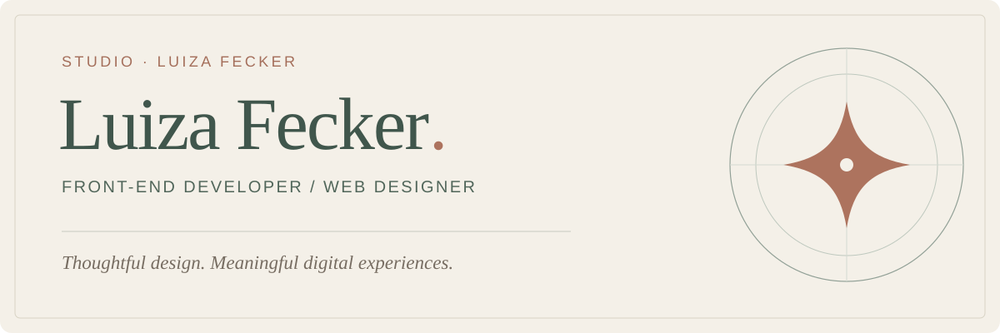

## Hi, I'm Luiza 👋

I'm a **front-end developer and web designer** who brings together design, usability and development to create thoughtful digital experiences.

I'm the founder of **Studio Luiza Fecker**. With more than five years of experience in web design and development, I work with clients in Brazil and beyond. Together, my team and I have worked on **400+ projects** through the studio.

### What I create

- **Websites & landing pages** — responsive digital experiences designed around real goals.
- **WordPress & online stores** — tailored websites and e-commerce experiences using WordPress, Elementor and WooCommerce.
- **Web interfaces & applications** — practical interfaces that connect visual design with functionality.

### Tools & technologies

**Front end:** HTML · CSS · JavaScript  
**Web platforms:** WordPress · Elementor · WooCommerce  
**Design & workflow:** Figma · Git · GitHub

### Selected work

- [**Angelini** — multi-page website](https://luizafecker.com/projeto/angelini/)  
  A welcoming website created to present a psychologist's services and approach.
- [**Mariana Lima** — landing page](https://luizafecker.com/projeto/mariana-lima/)  
  A landing page designed to connect and engage a professional community.

[Explore more projects on the Studio website →](https://luizafecker.com/)

### Let's connect

[Website & portfolio](https://luizafecker.com/) · [LinkedIn](https://www.linkedin.com/in/luiza-fecker-a1399520b/) · [Instagram](https://www.instagram.com/luizafecker.dev/)

🇧🇷 Leia em português

### Oi, eu sou a Luiza!

Sou desenvolvedora front-end, web designer e fundadora do Studio Luiza Fecker. Uno design, estratégia e desenvolvimento para criar sites, landing pages, lojas e experiências digitais pensadas para as pessoas.

Tenho mais de cinco anos de experiência na área e, junto com minha equipe, já trabalhei em mais de 400 projetos pelo Studio. Atendo clientes no Brasil e no exterior.

[Conheça meu portfólio](https://luizafecker.com/) · [Vamos nos conectar no LinkedIn](https://www.linkedin.com/in/luiza-fecker-a1399520b/)

