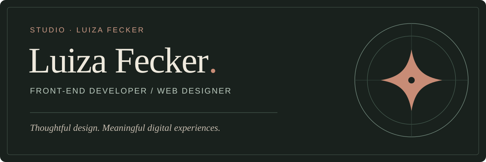

## Hi, I'm Luiza 👋

I'm a **front-end developer and web designer** who brings together design, usability and development to create thoughtful digital experiences.

Here on GitHub, I store the foundations and development files that serve as the starting point for my work.

I'm the founder of **Studio Luiza Fecker**. With more than five years of experience in web design and development, I work with clients in Brazil and beyond. Together, my team and I have worked on **400+ projects** through the studio.

### What I create

- **Websites & landing pages** — responsive digital experiences designed around real goals.
- **WordPress & online stores** — tailored websites and e-commerce experiences using WordPress, Elementor and WooCommerce.
- **Web interfaces & applications** — practical interfaces that connect visual design with functionality.

### Tools & technologies

  &nbsp;&nbsp;
  &nbsp;&nbsp;
  &nbsp;&nbsp;
  &nbsp;&nbsp;
  &nbsp;&nbsp;
  &nbsp;&nbsp;
  &nbsp;&nbsp;
  

**Front end:** HTML · CSS · JavaScript  
**Web platforms:** WordPress · Elementor · WooCommerce  
**Design & workflow:** Figma · Git · GitHub

### Projects

Explore my work and completed projects on the [Studio portfolio](https://luizafecker.com/projetos/).

### Let's connect

*Não pode contra eles, então junte-se a eles 😅*

🤖 [Meu perfil no ChatGPT](https://chatgpt.com/u/luizafecker)

🇧🇷 Leia em português

### Oi, eu sou a Luiza!

Sou desenvolvedora front-end, web designer e fundadora do Studio Luiza Fecker. Uno design, estratégia e desenvolvimento para criar sites, landing pages, lojas e experiências digitais pensadas para as pessoas.

Aqui no GitHub, armazeno as bases de criação e desenvolvimento dos meus trabalhos.

Tenho mais de cinco anos de experiência na área e, junto com minha equipe, já trabalhei em mais de 400 projetos pelo Studio. Atendo clientes no Brasil e no exterior.
